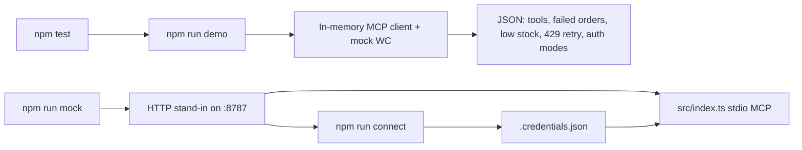
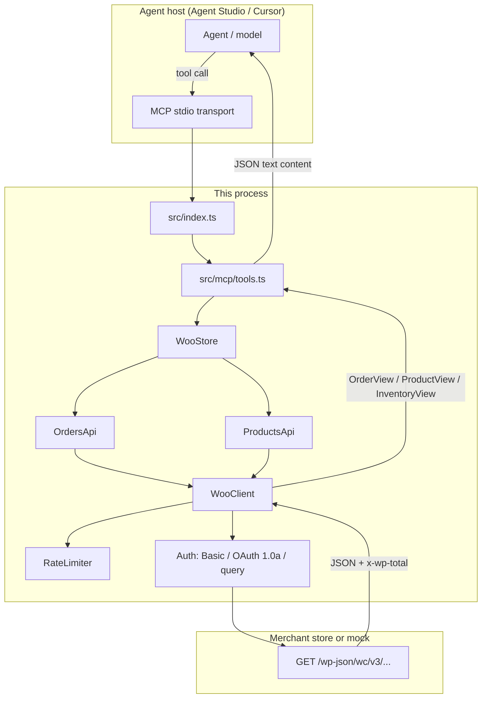
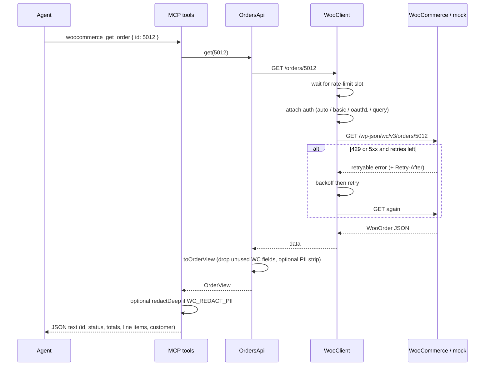
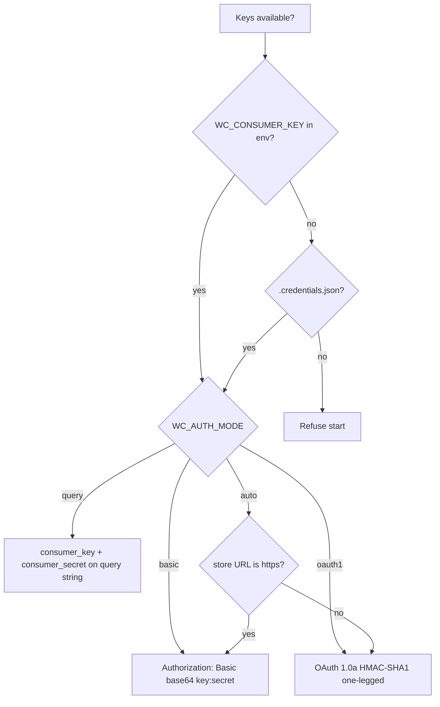
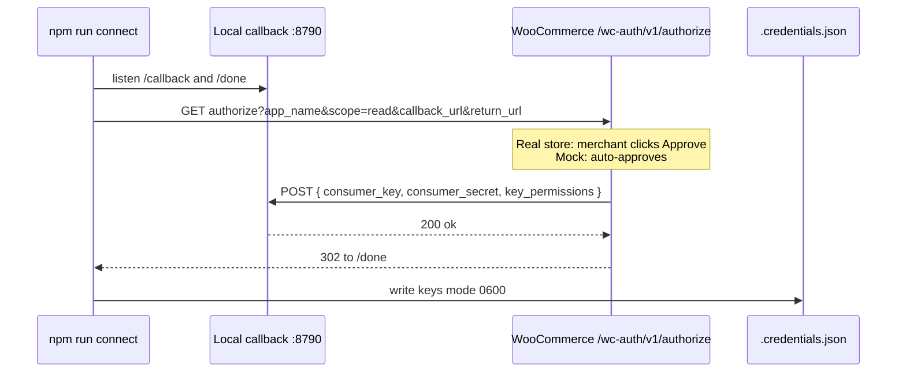
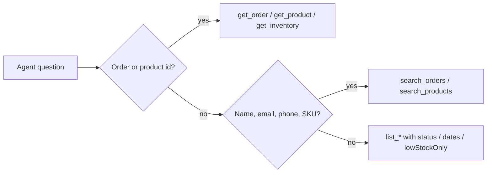
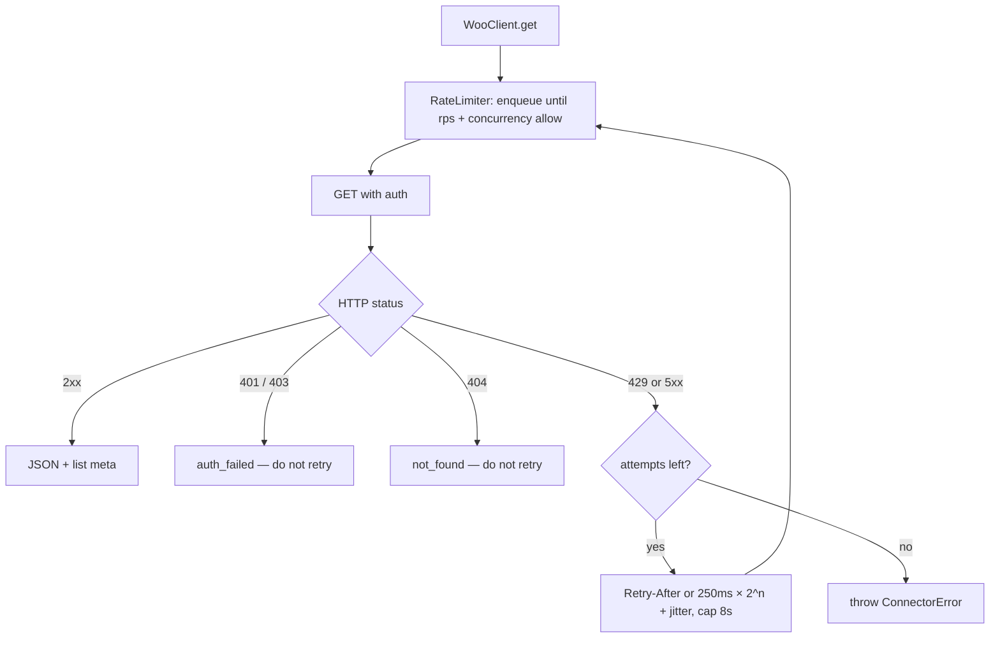

# WooCommerce connector for Agent Studio

Razorpay Forward-Deployed Engineer assignment — option 3: a private connector that lets an Agent Studio agent read **orders**, **products**, and **inventory** from a merchant WooCommerce store.

WooCommerce is the target because it is a common Razorpay checkout surface. The connector is **read-only**, runs as an [MCP](https://modelcontextprotocol.io) server, and can be demonstrated without a live store.

## What to run (evaluator path)

Requires Node.js 20+. No WooCommerce install, API keys, or customer data needed.

```bash
npm install
cp .env.example .env
npm test
npm run demo
```

Expected: tests pass, then `demo` prints JSON with MCP tool names, a failed-order recovery slice, low-stock SKUs, and proof that 429 retry, OAuth 1.0a, and query-string API keys all work against the mock.

Optional live mock (leave it running, then point `.env` at it):

```bash
npm run mock
# in another shell
npm run connect -- --store-url http://127.0.0.1:8787
npx tsx src/index.ts   # MCP stdio server
```



## Why this shape

A merchant will often ask for “an agent that checks orders.” The useful job is narrower: give the agent a small set of **list / get / search** tools, a **read-only** key, and client-side rate limits so it cannot scrape the WordPress host.

Typical Agent Studio turns this unlocks:

- “Why did yesterday’s UPI orders fail?” → `woocommerce_search_orders` with `status=failed`
- “Is POS paper actually in stock?” → `woocommerce_list_inventory` with `lowStockOnly=true`
- “Pull order 5012 for this ticket.” → `woocommerce_get_order`

## How it works

The process is an MCP server, not a public HTTP API. Agent Studio (or Cursor) starts `src/index.ts` over **stdio**. The server registers eight tools. Each tool call becomes a GET against WooCommerce REST API v3 (`/wp-json/wc/v3/...`). Responses are trimmed into small views before they reach the model.



Nothing in this repo registers POST, PUT, or DELETE on `/wp-json/wc/v3`. Inventory is not a separate WooCommerce resource: it is a derived view of catalog products (quantity, `manage_stock`, stock status, plus a computed `lowStock` flag).

### One tool call, end to end

Example: support ticket already has order id `5012`.



List and search follow the same path, with `page` / `perPage` (capped at 50) and WooCommerce list headers `x-wp-total` / `x-wp-totalpages` mapped into `meta`.

### Config load order

`loadConfig()` in `src/config.ts` fills fields in this order (first non-empty wins per field):

1. Explicit overrides (used by `npm run demo` and tests)
2. Process env / `.env`
3. `.credentials.json` from `npm run connect` (store URL + consumer key/secret only)
4. Defaults: `authMode=auto`, 5 rps, 4 retries, concurrency 3, PII redaction off

`assertConfigured()` refuses to start the stdio server without a store URL and both consumer credentials.

## Authentication

Two supported onboarding paths (assignment: OAuth **or** API key — both are implemented). After keys exist, every REST call uses one of three transports.



`auto` matches WooCommerce’s own guidance: HTTP Basic on HTTPS; OAuth 1.0a on HTTP because many hosts strip `Authorization` or because Basic over cleartext is the worse option. `query` exists for hosts that strip the header entirely.

### 1. WooCommerce app authentication (merchant consent)

WooCommerce does not speak OAuth 2.0. The supported consent flow is [`/wc-auth/v1/authorize`](https://woocommerce.github.io/woocommerce-rest-api-docs/#authentication): the merchant approves a named app; WooCommerce **POST**s a consumer key/secret to your callback.

```bash
npm run connect -- --store-url https://merchant.example --app-name "Razorpay Agent Studio" --scope read
```

Against the mock store, `connect` auto-approves and writes `.credentials.json` (gitignored). Against a real store, the merchant must click Approve on the authorize URL printed to stderr.

Scope is **`read` only**. Write keys are refused at the product level: this server never sends POST/PUT/DELETE to `/wp-json/wc/v3`.



### 2. API keys

Create a key in WooCommerce → Settings → Advanced → REST API, permissions **Read**. Then:

```
WC_STORE_URL=https://merchant.example
WC_CONSUMER_KEY=ck_...
WC_CONSUMER_SECRET=cs_...
WC_AUTH_MODE=auto
```

## MCP tools

Canonical spec: [`docs/mcp-tools.json`](docs/mcp-tools.json). Behaviour and limits: [`docs/AGENT_CAPABILITIES.md`](docs/AGENT_CAPABILITIES.md).

| Tool | Primitive | Upstream |
| --- | --- | --- |
| `woocommerce_list_orders` | list | `GET /orders` |
| `woocommerce_get_order` | get | `GET /orders/{id}` |
| `woocommerce_search_orders` | search | `GET /orders?search=` |
| `woocommerce_list_products` | list | `GET /products` |
| `woocommerce_get_product` | get | `GET /products/{id}` |
| `woocommerce_search_products` | search | `GET /products?search=` and/or `sku=` |
| `woocommerce_list_inventory` | list | `GET /products` then map to inventory rows |
| `woocommerce_get_inventory` | get | `GET /products/{id}` + inventory row for that SKU |

The agent should prefer **get** when the ticket already has an id, **search** when it has a name/email/SKU, and **list** only for bounded windows (`status`, `after`/`before`, pagination). Page size is capped at 50 in the connector even if the model asks for more.



Cursor / Agent Studio stdio config:

```json
{
  "mcpServers": {
    "woocommerce": {
      "command": "npx",
      "args": ["tsx", "src/index.ts"],
      "cwd": "/absolute/path/to/razar",
      "env": {
        "WC_STORE_URL": "http://127.0.0.1:8787",
        "WC_CONSUMER_KEY": "ck_demo_key",
        "WC_CONSUMER_SECRET": "cs_demo_secret"
      }
    }
  }
}
```

### What the model actually sees

Raw WooCommerce orders include billing/shipping addresses and a large line-item payload. The connector maps that down so the model is not dumped a WordPress object:

- **OrderView** — id, number, status, total, currency, payment method label, createdAt, customer name (+ email/phone unless redacted), line items (name, SKU, qty, total)
- **ProductView** — id, name, SKU, status, price, stock fields
- **InventoryView** — productId, name, SKU, stockStatus, quantity, manageStock, `lowStock`

`lowStock` is true when status is not `instock`, or when stock is managed and quantity is at or under `low_stock_amount` (default threshold 5 if WooCommerce left it null).

If `WC_REDACT_PII=true`, email/phone/address-like keys are stripped or replaced after the view is built. Logs never print those fields; they log status codes and URLs with consumer query params stripped.

Tool failures are returned as MCP `isError` with a short code (`auth_failed`, `not_found`, `rate_limited`, `upstream_error`, `http_error`) rather than a stack trace.

## Rate limits

WooCommerce REST API v3 has **no published global quota**. Hosts, WAFs, and some Store API settings still throttle. The client:

- spaces requests (`WC_RATE_LIMIT_RPS`, default 5)
- caps in-flight calls (`WC_MAX_CONCURRENCY`, default 3)
- retries 429 and 5xx with exponential backoff, jitter, and `Retry-After`



401/403 are not retried: a bad or write-scoped key will not be guessed. The mock can inject a single 429 (`forceRateLimitOnce`) so `npm run demo` proves the retry path without a real WAF.

## Mock store

`src/mock/httpServer.ts` is a local stand-in for `/wp-json/wc/v3` plus `/wc-auth/v1/authorize`. It accepts the demo pair `ck_demo_key` / `cs_demo_secret` via Basic, query string, or a valid OAuth 1.0a signature.

Fictional catalog (`.test` emails, non-routable phones): four products (including an out-of-stock soundbox stand and low-stock POS paper) and five orders spanning `failed`, `processing`, and `completed`. The mock search is slightly richer than stock WooCommerce (`number`, name, email, phone, SKU) so the failed-payment recovery demo is deterministic.

`npm run demo` does not need `npm run mock`. It boots the mock on an ephemeral port, wires an in-memory MCP client to the same tool surface Agent Studio would see, exercises search/get/inventory, forces one 429, then repeats a call with OAuth 1.0a and query auth.

## Project layout

```
src/auth/          Basic, query-string, OAuth 1.0a
src/http/          Client, errors, rate limiter
src/wc/            Orders / products / inventory views
src/mcp/           MCP tool registration
src/mock/          Local WooCommerce stand-in + fictional catalog
src/cli/connect.ts App-auth callback
src/demo.ts        End-to-end demonstration
docs/              Tool spec + agent can/cannot
```

## Assumptions

- Node 20+ `fetch` is available.
- The merchant store exposes `/wp-json/wc/v3` and, for consent, `/wc-auth/v1/authorize`.
- Demo data is fictional (`.test` emails, non-routable phones).
- Agent Studio can host an MCP stdio or in-process server; HTTP MCP transport is not required for this submission.

## Limitations

- Read-only: cannot refund, restock, capture, or change order status.
- WooCommerce `search` is store-defined; the mock searches number/name/email/phone/SKU, which is slightly richer than a stock WC search.
- No webhook ingest; the agent polls. For production, subscribe to `order.updated` and cache.
- OAuth 1.0a is signed with HMAC-SHA1 because that is what WooCommerce requires on HTTP.
- A real production connector should store keys in a merchant secret manager, not `.credentials.json`.

## Production follow-up (if this shipped)

1. Tenant-isolated secrets, short-lived cache, and audit logs of every tool call.
2. Webhooks instead of list polling for failed-payment recovery.
3. Explicit allow-list of order statuses and fields (drop billing address unless the ticket needs it).
4. Measure: time-to-first-order-context on support tickets, and failed-order follow-up rate before vs after the agent.
